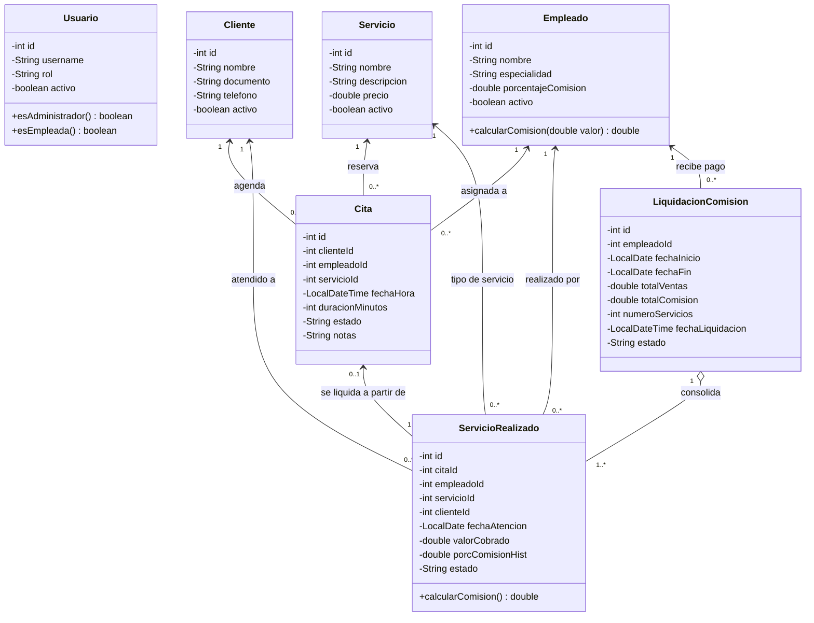

# Salón de Belleza Aremi - Arquitectura del Sistema

Sistema de información de escritorio para la administración de citas, registro de servicios realizados y liquidación de comisiones del personal para el Salón de Belleza Aremi.

---

## 1. Arquitectura de Software: Modelo - Vista - Controlador (MVC) + DAO

El sistema está estructurado bajo la arquitectura en capas Modelo-Vista-Controlador (MVC), complementada con el patrón de acceso a datos **DAO (Data Access Object)**:

```
src/
├── model/                  --> Entidades del dominio (POJOs puros)
│   ├── Cliente.java
│   ├── Empleado.java
│   ├── Servicio.java
│   ├── Cita.java
│   ├── ServicioRealizado.java
│   ├── LiquidacionComision.java
│   └── Usuario.java
│
├── dao/                    --> Capa de persistencia exclusiva (JDBC)
│   ├── ConexionBD.java     --> Conexión Singleton
│   ├── ClienteDAO.java
│   ├── EmpleadoDAO.java
│   ├── ServicioDAO.java
│   ├── CitaDAO.java
│   ├── ServicioRealizadoDAO.java
│   ├── LiquidacionDAO.java
│   └── UsuarioDAO.java
│
├── controller/             --> Lógica de negocio y validaciones
│   ├── ClienteController.java
│   ├── EmpleadoController.java
│   ├── ServicioController.java
│   ├── CitaController.java
│   ├── ServicioRealizadoController.java
│   ├── LiquidacionController.java
│   └── AuthController.java
│
├── view/                   --> Vistas e interfaces gráficas Swing
│   ├── LoginSystemAremi.java
│   ├── MainApplication.java
│   ├── InterfazClientes.java
│   ├── GestionEmpleadasGUI.java
│   ├── GestionServiciosGUI.java
│   ├── AgendarCitaGUI.java
│   ├── ServiciosRealizadosGUI.java
│   ├── LiquidacionComisionesGUI.java
│   └── ConfiguracionDBDialog.java
│
└── util/                   --> Componentes transversales
    ├── SeguridadManager.java
    └── ReportePDFGenerator.java
```

---

## 2. Diagrama de Clases UML del Dominio



---

## 3. Patrones de Diseño Implementados

### 3.1 Singleton (`ConexionBD`)
Garantiza una única instancia de conexión activa a la base de datos, optimizando el uso de recursos y leyendo los parámetros de configuración de forma desacoplada desde `db.properties`.

### 3.2 Data Access Object (DAO)
Encapsula todas las sentencias SQL y operaciones JDBC dentro de clases especializadas (`ClienteDAO`, `CitaDAO`, `LiquidacionDAO`, etc.). La capa de presentación (`view`) desconoce los detalles de persistencia y no contiene sentencias SQL.

### 3.3 Modelo - Vista - Controlador (MVC)
Separa claramente los datos de la aplicación (`model`), las pantallas de usuario (`view`) y la coordinación de flujo y reglas de negocio (`controller`).
