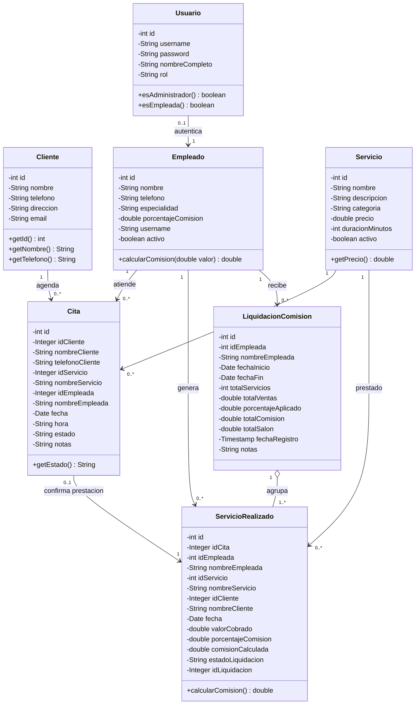

# 💅 SALÓN DE BELLEZA AREMI - ARQUITECTURA MVC & GUÍA DE SUSTENTACIÓN

**Asignatura:** Programación II / Ingeniería de Software I  
**Institución:** Institución Universitaria Antonio José Camacho (UNIAJC)  
**Grupo:** 411  

---

## 👥 Integrantes y Distribución Individual de Sustentación

El docente evaluará que cada estudiante explique y defienda una clase del sistema. A continuación se detalla la especialidad, clase asignada, responsabilidades y respuestas clave para la sustentación:

| Integrante | Capa / Módulo Asignado | Clases Principales | Rol en la Exposición |
| :--- | :--- | :--- | :--- |
| **Erick Johan Enriquez Vera** | **Capa de Negocio y Citas** | `Cita`, `CitaController`, `CitaDAO`, `AgendarCitaGUI` | Explica la validación de disponibilidad y prevención de solapamiento de horarios (RF-06), el desacoplamiento de eventos Swing y la transición de estados de una cita. |
| **Jeram Jeamdro Salazar Calderón** | **Capa de Finanzas y Liquidaciones** | `ServicioRealizado`, `LiquidacionComision`, `LiquidacionController`, `LiquidacionDAO`, `ReportePDFGenerator` | Explica el cálculo de comisiones según especialidad (Ashley 20%, Monika 30%, Veronika 50%), la transacción atómica de liquidación y la generación del comprobante en PDF con iText. |
| **Yeneicy Alexandra Michileno Salcedo** | **Capa de Persistencia y Seguridad** | `ConexionBD` (Singleton), `Usuario`, `UsuarioDAO`, `AuthController`, `ClienteDAO`, `EmpleadoDAO` | Explica la conexión centralizada con patrón Singleton, la eliminación de claves root en código (archivo `db.properties`), el hashing seguro SHA-256 y el patrón Data Access Object (DAO). |

---

## 🏛️ 1. Arquitectura del Software: Modelo - Vista - Controlador (MVC) + DAO

El software ha sido refactorizado separando responsabilidades estrictas en 5 paquetes independientes:

```
src/
├── model/                  --> Entidades del dominio (POJOs puros, sin SQL)
│   ├── Cliente.java
│   ├── Empleado.java
│   ├── Servicio.java
│   ├── Cita.java
│   ├── ServicioRealizado.java
│   ├── LiquidacionComision.java
│   └── Usuario.java
│
├── dao/                    --> Capa de Persistencia exclusiva (JDBC con PreparedStatement)
│   ├── ConexionBD.java     --> Conexión Singleton única (elimina credenciales quemadas)
│   ├── ClienteDAO.java
│   ├── EmpleadoDAO.java
│   ├── ServicioDAO.java
│   ├── CitaDAO.java
│   ├── ServicioRealizadoDAO.java
│   ├── LiquidacionDAO.java
│   └── UsuarioDAO.java
│
├── controller/             --> Lógica de negocio, validaciones y mediación
│   ├── ClienteController.java
│   ├── EmpleadoController.java
│   ├── ServicioController.java
│   ├── CitaController.java
│   ├── ServicioRealizadoController.java
│   ├── LiquidacionController.java
│   └── AuthController.java
│
├── view/                   --> Interfaces Swing limpias (CERO SQL, solo capturan eventos)
│   ├── LoginSystemAremi.java
│   ├── MainApplication.java
│   ├── InterfazClientes.java
│   ├── GestionEmpleadasGUI.java
│   ├── GestionServiciosGUI.java
│   ├── AgendarCitaGUI.java
│   ├── ServiciosRealizadosGUI.java
│   ├── LiquidacionComisionesGUI.java
│   └── ConfiguracionDBDialog.java
│
└── util/                   --> Utilidades transversales
    ├── SeguridadManager.java
    └── ReportePDFGenerator.java
```

---

## 📊 2. Diagrama de Clases UML Real del Dominio

Este diagrama refleja exactamente lo implementado en el código fuente (incluyendo `ServicioRealizado` y `LiquidacionComision` que faltaban en el documento previo):



---

## 🔒 3. Conexión Única y Segura (Patrón Singleton)

### ¿Qué se corrigió?
1. Se redujeron las 4 clases de conexión anteriores (`DatabaseConnection`, `DatabaseConfig`, `ConnectionPool`) a **una sola clase**: `dao.ConexionBD`.
2. Se eliminaron las contraseñas quemadas (`password = "admin1023"` y credenciales root en texto plano).
3. Ahora la configuración se lee desde `db.properties`. Si el archivo no existe, por defecto usa la base de datos embebida **H2** (`jdbc:h2:./salon_aremi_db;MODE=MySQL;DATABASE_TO_LOWER=TRUE`) con usuario `sa` y sin contraseña, garantizando portabilidad inmediata en cualquier computador sin requerir servidor MySQL.

---

## 📚 4. Diez Referencias Bibliográficas Reales (Normas IEEE / APA 7)

*(Sustituyen los enlaces a redes sociales por literatura académica rigurosa de Ingeniería de Software y Programación Orientada a Objetos)*:

1. **Gamma, E., Helm, R., Johnson, R., & Vlissides, J. (1994).** *Design Patterns: Elements of Reusable Object-Oriented Software*. Addison-Wesley Professional. *(Fundamento de los patrones Singleton, DAO y MVC aplicados en el proyecto).*
2. **Pressman, R. S., & Maxim, B. R. (2020).** *Ingeniería del software: Un enfoque práctico* (9.ª ed.). McGraw-Hill Interamericana. *(Metodología de desarrollo incremental y modelado de requerimientos).*
3. **Sommerville, I. (2019).** *Ingeniería de Software* (10.ª ed.). Pearson Educación. *(Arquitectura de sistemas basados en componentes y separación de capas de negocio y persistencia).*
4. **Fowler, M. (2018).** *Refactoring: Improving the Design of Existing Code* (2nd ed.). Addison-Wesley Professional. *(Principios de refactorización hacia código limpio y desacoplamiento de interfaces gráficas).*
5. **Martin, R. C. (2017).** *Clean Architecture: A Craftsman's Guide to Software Structure and Design*. Prentice Hall. *(Regla de dependencias e independencia de la base de datos respecto a las vistas).*
6. **Bloch, J. (2018).** *Effective Java* (3rd ed.). Addison-Wesley Professional. *(Mejores prácticas en diseño de clases POJO, manejo de excepciones y concurrencia en JDBC).*
7. **Elmasri, R., & Navathe, S. B. (2017).** *Fundamentos de sistemas de bases de datos* (7.ª ed.). Pearson Educación. *(Normalización relacional, integridad referencial y transacciones ACID).*
8. **Oracle Corporation. (2023).** *Trail: Creating a GUI With JFC/Swing*. Oracle Java Documentation. https://docs.oracle.com/javase/tutorial/uiswing/ *(Manejo de eventos, layouts y modelos de tabla en interfaces gráficas Java).*
9. **Oracle Corporation. (2023).** *Java Database Connectivity (JDBC) Guide*. Oracle Technology Network. https://docs.oracle.com/javase/8/docs/technotes/guides/jdbc/ *(Uso de PreparedStatement para evitar inyecciones SQL y administración de conexiones).*
10. **Freeman, E., & Robson, E. (2020).** *Head First Design Patterns: Building Extensible and Maintainable Object-Oriented Software* (2nd ed.). O'Reilly Media. *(Explicación pedagógica de la arquitectura Modelo-Vista-Controlador).*

---

## 🎓 5. Guion de Respuestas para la Sustentación frente al Docente

### Pregunta 1: "¿Por qué afirman que su sistema cumple el patrón MVC?"
> **Respuesta del equipo:**
> *"Profesor, porque separamos estrictamente las responsabilidades:  
> 1. Las **Vistas** (`view.*`) solo dibujan componentes Swing y capturan eventos del usuario; ninguna vista tiene `import java.sql.*` ni ejecuta una consulta SQL.  
> 2. Los **Controladores** (`controller.*`) reciben las peticiones de las vistas, validan las reglas del negocio (como que no haya cruce de horario o que el porcentaje esté entre 0 y 100) y coordinan las operaciones.  
> 3. Los **DAOs** (`dao.*`) son los únicos que conocen el lenguaje SQL y la base de datos mediante sentencias preparadas (`PreparedStatement`).  
> 4. Los **Modelos** (`model.*`) son entidades puras POJO que transportan los datos entre capas."*

### Pregunta 2 (Dirigida a Erick): "¿Dónde se valida que dos citas no se solapen?"
> **Respuesta de Erick:**
> *"Se valida en la capa de negocio a través de `CitaController.agendarCita()`. Antes de guardar, el controlador invoca a `CitaDAO.existeCruceHorario(idEmpleada, fecha, hora)`. Si la consulta detecta que la empleada ya tiene una cita activa en esa franja horaria, el controlador lanza una excepción de negocio que la vista `AgendarCitaGUI` atrapa mostrando una alerta clara al usuario, impidiendo que el registro inconsistente llegue a la base de datos."*

### Pregunta 3 (Dirigida a Jeram): "¿Cómo calculan y liquidan las comisiones?"
> **Respuesta de Jeram:**
> *"Las citas no generan comisiones por sí solas. Cuando la cita se presta, se registra como `ServicioRealizado`. En `LiquidacionController`, la administradora consulta los servicios prestados por una empleada en un rango de fechas. El sistema calcula la comisión según el porcentaje configurado para su especialidad (Ashley 20% en Uñas, Monika 30% en Cejas, Veronika 50% en Depilación). Luego, `LiquidacionDAO` ejecuta una **transacción atómica** (`conn.setAutoCommit(false)`): registra la cabecera en la tabla `liquidaciones`, actualiza los servicios a estado 'Liquidado' y confirma con `conn.commit()`. Finalmente, `ReportePDFGenerator` utiliza la librería iText para emitir el comprobante oficial."*

### Pregunta 4 (Dirigida a Yeneicy): "¿Cómo manejan la conexión a la base de datos y la seguridad?"
> **Respuesta de Yeneicy:**
> *"Aplicamos el patrón **Singleton** en `ConexionBD` para garantizar una única instancia de gestión de conexiones en toda la aplicación. Eliminamos las contraseñas quemadas en el código: las credenciales se leen desde un archivo externo `db.properties` y, si este no existe, el sistema utiliza la base de datos embebida H2 para máxima portabilidad sin requerir configuración manual. Además, en `UsuarioDAO` y `SeguridadManager` las contraseñas nunca se guardan en texto plano; se procesan mediante algoritmo de hash criptográfico **SHA-256**."*
